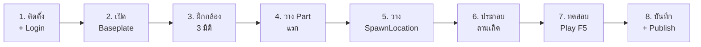

---
title: "Roblox Studio Day 1 — เริ่มสร้างเกมแรก: ลานจุดเกิดของฉัน"
aliases:
  - Roblox Studio Day 1
  - Roblox Day 1
  - เริ่มสร้างเกมแรก
  - ลานจุดเกิดแรก
  - Lab 1 Roblox
tags:
  - การสอน
  - เนื้อหาบทเรียน
  - ปฏิบัติการ
  - roblox-studio
  - game-development
  - 3d
  - ปวช
  - วิทยาลัยเทคนิคลพบุรี
course_code: 21901-2009
week: 1
day: 1
tool: Roblox Studio
created: 2026-10-25
updated: 2026-10-25
status: เนื้อหาปฏิบัติการฉบับสมบูรณ์ (สอนทีละขั้นตอน)
---

# Roblox Studio Day 1 — เริ่มสร้างเกมแรก: ลานจุดเกิดของฉัน

*(Day 1: Install, Explore, Build Your First Spawn Arena)*

> [!info] ข้อมูลบทเรียน
> | รายการ | รายละเอียด |
> | :--- | :--- |
> | รายวิชา | `21901-2009` การสร้างเกมคอมพิวเตอร์ |
> | สัปดาห์ / คาบ | สัปดาห์ที่ 1 · คาบที่ 8–9 (ปฏิบัติการ) |
> | เวลาที่ใช้ | 2 ชั่วโมง (14.40–16.30 น.) |
> | ห้องเรียน | TC203 |
> | เครื่องมือ | Roblox Studio (เวอร์ชันล่าสุด) + บัญชี Roblox |
> | ผลงานที่ต้องได้ | **ลานจุดเกิด (Spawn Arena) ของตัวเอง 1 แห่ง** ที่กด Play แล้วตัวละครเกิดถูกตำแหน่ง |

> [!abstract] เป้าหมายของ Day 1 (ทำได้ครบหรือยัง?)
> 1. ติดตั้ง Roblox Studio และเข้าสู่ระบบได้
> 2. เปิดโปรเจกต์จากเทมเพลต **Baseplate** ได้
> 3. ควบคุมกล้อง 3 มิติได้คล่อง (หมุน / เคลื่อน / ซูม / โฟกัส)
> 4. วาง ปรับขนาด หมุน และตั้งค่า **Part** ได้
> 5. วาง **SpawnLocation** และสร้างลานเกิดของตัวเองได้
> 6. กด **Play (F5)** ทดสอบ และ **บันทึกงาน** ได้

> [!note] Day 1 ยังไม่เขียนโค้ด
> บทนี้เป็น **ปฏิบัติการสร้างฉากล้วน ๆ** ยังไม่มี Lua Script — เราจะเริ่มเขียนโค้ดกันในสัปดาห์ที่ 6
> วันนี้ขอให้ "สร้างเป็น" และ "ทดสอบเป็น" ก่อน

---

## 1. ภาพรวม 8 ขั้นของวันนี้

> [!tip] กฎสำคัญที่สุดของวันนี้
> **Anchored ทุกชิ้น!** ถ้าลืมติ๊ก `Anchored` สิ่งที่สร้างจะร่วงลงพื้นหรือกระเด็นเมื่อตัวละครชน
> จำประโยคนี้ให้ขึ้นใจ: **"วางปุ๊บ ติ๊กปั๊บ"**

---

## 2. ขั้นที่ 1 — เตรียมบัญชีและติดตั้ง Roblox Studio

### 2.1 สมัครบัญชี Roblox (ถ้ายังไม่มี)

1. เปิดเบราว์เซอร์ไปที่ **`roblox.com`**
2. คลิก **Sign Up**
3. กรอกวันเกิด ชื่อผู้ใช้ (Username) และรหัสผ่าน
4. ยืนยันอีเมล (ถ้ามี) เพื่อความปลอดภัยของบัญชี
5. จด Username และรหัสผ่านเก็บไว้ — **ห้ามใช้รหัสเดียวกับอีเมลหรือบัญชีธนาคาร**

> [!warning] ความปลอดภัยของบัญชี
> * ห้ามบอกUsername/รหัสผ่านให้เพื่อน
> * อย่ากดลิงก์ที่อ้างว่า "ได้ Robux ฟรี" — เป็นการหลอกลวงทั้งหมด
> * ใช้บัญชีของตัวเองเท่านั้น เพราะงานทุกชิ้นจะผูกกับบัญชีนี้

### 2.2 ดาวน์โหลดและติดตั้ง

1. ไปที่ **`create.roblox.com`**
2. คลิก **Start Creating** หรือ **Download Studio**
3. เลือกเวอร์ชันให้ตรงกับระบบปฏิบัติการ (Windows / macOS)
4. เปิดไฟล์ที่ดาวน์โหลด แล้วกด **Install**
5. เปิดโปรแกรม **Roblox Studio** ขึ้นมา

### 2.3 ข้อกำหนดเครื่องขั้นต่ำ

| รายการ | ขั้นต่ำ | แนะนำ |
| :--- | :--- | :--- |
| ระบบปฏิบัติการ | Windows 10 / macOS 10.13 | Windows 11 |
| หน่วยความจำ (RAM) | 4 GB | 8 GB ขึ้นไป |
| พื้นที่ว่าง | 1 GB | 5 GB |
| การ์ดจอ | รองรับ DirectX 11 | การ์ดจอแยก |
| อินเทอร์เน็ต | ต้องมี (ใช้ล็อกอินและบันทึกงาน) | ความเร็วสูง |

### 2.4 เช็กลิสต์ก่อนเข้าเรียน

- [ ] มีบัญชี Roblox ที่ล็อกอินได้
- [ ] ติดตั้ง Roblox Studio สำเร็จ
- [ ] เปิดโปรแกรมแล้วเห็นหน้าแรก (Home) พร้อมรายการโปรเจกต์
- [ ] ต่ออินเทอร์เน็ตได้ (สำหรับ Save/Publish)

---

## 3. ขั้นที่ 2 — เปิดโปรเจกต์แรก (Baseplate)

1. เปิด **Roblox Studio**
2. ถ้าหน้าแรกแสดงเทมเพลต ให้เลือกแท็บ **New**
3. เลือกเทมเพลต **Baseplate** (บางเวอร์ชันเรียกว่า *Classic Baseplate*)
4. รอสักครู่ จะได้ฉากเริ่มต้นที่มี
   * **Baseplate** — พื้นสี่เหลี่ยมขนาดใหญ่
   * **SpawnLocation** — แท่นเกิดของผู้เล่น อยู่กลางฉาก
   * **Camera** — กล้องของโหมดแก้ไข
   * **Lighting** — ระบบแสง

> [!tip] บันทึกก่อนทำอะไร
> กด **Ctrl + S** ทันที แล้วตั้งชื่อโปรเจกต์ว่า **`SpawnArena_<ชื่อเล่น>`**
> เช่น `SpawnArena_นนท์` — กันงานหายเมื่อโปรแกรมค้าง

### 3.1 รู้จัก Explorer: แผนที่ของโลกเรา

ที่หน้าต่าง **Explorer** (มุมขวาบน) จะเห็นโครงสร้างแบบต้นไม้

| ชื่อ | คืออะไร |
| :--- | :--- |
| **Workspace** | โลก 3 มิติทั้งหมดที่ผู้เล่นเห็น (Part ทุกชิ้นอยู่ที่นี่) |
| **Players** | รายชื่อผู้เล่นที่อยู่ในเซิร์ฟเวอร์ |
| **Lighting** | แสงและบรรยากาศ |
| **ReplicatedStorage** | ที่เก็บของที่ใช้ร่วมกันทั้งเกม |
| **ServerScriptService** | ที่เก็บสคริปต์ฝั่งเซิร์ฟเวอร์ (สัปดาห์ที่ 6) |
| **StarterGui** | หน้าจอ UI ของผู้เล่น |

> [!note] ทำไมต้องรู้ Explorer
> เพราะทุกอย่างที่เราสร้างจะไปอยู่ใน **Workspace** และเราจะเลือก ปรับ หรือลบมันผ่าน Explorer นี้

---

## 4. ขั้นที่ 3 — ฝึกบังคับกล้อง 3 มิติ (สำคัญมาก)

**กล้องคือมือของเรา** — ถ้าคุมกล้องไม่ได้ จะวางของไม่ได้เลย

### 4.1 คำสั่งควบคุมกล้อง

| การกระทำ | วิธีทำ |
| :--- | :--- |
| **หมุนมองรอบตัว** | กด **คลิกขวาค้าง** แล้วลากเมาส์ |
| **เดินหน้า/ถอยหลัง** | **W / S** (ขณะคลิกขวาค้าง) |
| **เลี้ยวซ้าย/ขวา** | **A / D** |
| **ลอยขึ้น / จมลง** | **E / Q** |
| **ซูมเข้า-ออก** | หมุน **ล้อเมาส์** |
| **โฟกัสวัตถุที่เลือก** | กด **F** |
| **เร่งความเร็วกล้อง** | กด **Shift** ค้าง |

> [!warning] ข้อผิดพลาดที่มือใหม่เจอบ่อย
> ถ้าลากเมาส์แล้ววัตถุถูกเลือกแทนที่จะหมุนกล้อง แปลว่า **ลืมกดคลิกขวาค้าง**
> จำไว้: **คลิกซ้าย = เลือกวัตถุ · คลิกขวาค้าง = หมุนกล้อง**

### 4.2 แบบฝึกหัดกล้อง 2 นาที

- [ ] หมุนรอบ Baseplate 1 รอบเต็ม
- [ ] บินขึ้นไปมองจากมุมสูง (E)
- [ ] ซูมเข้าหา SpawnLocation
- [ ] คลิกเลือก Baseplate แล้วกด **F** เพื่อโฟกัส
- [ ] กด **Shift + คลิกขวาลาก** เพื่อบินเร็วขึ้น

---

## 5. ขั้นที่ 4 — วาง Part ชิ้นแรก

### 5.1 การเพิ่ม Part

1. ที่แถบเมนูด้านบน เลือกแท็บ **Model**
2. คลิกปุ่ม **Part** (อาจมีลูกศรให้เลือกชนิด)
3. เลือก **Block**
4. Part จะถูกวางไว้กลางฉาก (หรือตรงจุดที่กล้องมองอยู่)

**ชนิดของ Part ที่ใช้บ่อย**

| ชนิด | ลักษณะ | ใช้ทำอะไร |
| :--- | :--- | :--- |
| **Block** | กล่องสี่เหลี่ยม | พื้น ผนัง แท่น |
| **Sphere** | ทรงกลม | ลูกบอล ลูกโป่ง |
| **Cylinder** | ทรงกระบอก | เสา ถัง |
| **Wedge** | ลิ่ม/ทางลาด | บันไดลาด หลังคา |

### 5.2 เครื่องมือแปลงรูปทรง (Transform Tools)

เลือกเครื่องมือจากแถบ **Model** หรือกดที่ไอคอน

| เครื่องมือ | ใช้ทำอะไร | ลักษณะที่เห็น |
| :--- | :--- | :--- |
| **Select** | เลือกวัตถุ | ลูกศรชี้ |
| **Move** | เลื่อนตำแหน่ง | ลูกศร 3 แกน (แดง=X, เขียว=Y, น้ำเงิน=Z) |
| **Scale** | ยืด/หดขนาด | จุดสี่เหลี่ยมรอบวัตถุ |
| **Rotate** | หมุน | วงกลมรอบวัตถุ |

> [!tip] เทคนิคจัดวางให้ตรง
> เปิด **Snap to Grid** (แท็บ Model) แล้วเลือกขนาดกริด เช่น 1 หรือ 4 studs
> ของจะดูดเข้าตารางอัตโนมัติ ทำให้จัดฉากได้เป็นระเบียบและสมมาตร

### 5.3 ตั้งค่าที่ต้องรู้ใน Properties

เลือก Part แล้วดูหน้าต่าง **Properties** (ขวาล่าง) — ใช้ช่องค้นหาเพื่อหาคำสั่งเร็ว ๆ

| คุณสมบัติ | ค่า | ความหมาย |
| :--- | :--- | :--- |
| **Name** | ตั้งชื่อ เช่น `Podium` | ชื่อที่ใช้ใน Explorer (ตั้งให้สื่อความหมาย) |
| **Anchored** | ✅ ติ๊ก | **ล็อกไม่ให้ร่วง** (สำคัญที่สุด) |
| **Color** | เลือกสี | สีของชิ้นส่วน (เวอร์ชันเก่าใช้ `BrickColor`) |
| **Material** | Plastic / Wood / Neon / DiamondPlate | เนื้อผิววัสดุ |
| **Transparency** | 0 = ทึบ, 1 = โปร่งใส | ความโปร่งใส |
| **CanCollide** | ✅ / ❌ | เปิด = ชนได้ (ยืนทับได้) · ปิด = ทะลุผ่านได้ |
| **Size** | เช่น 20, 1, 20 | ขนาด (X, Y, Z) ในหน่วย stud |

> [!danger] กฎเหล็ก: Anchored
> ถ้าไม่ติ๊ก **Anchored** ชิ้นส่วนจะตกตามแรงโน้มถ่วงทันทีที่กด Play
> **ทุกชิ้นที่เราสร้างเอง ต้องติ๊ก Anchored** (ยกเว้นของที่ต้องการให้ลอย/กลิ้งจริง ๆ)

> [!note] stud คืออะไร
> **Stud** คือหน่วยวัดระยะใน Roblox ตัวละครผู้เล่นสูงประมาณ 5 studs
> ฉากที่เหมาะกับการเล่นมักใช้ความกว้างทางเดิน 8–12 studs

---

## 6. ขั้นที่ 5 — วาง SpawnLocation (จุดเกิดของผู้เล่น)

`SpawnLocation` คือวัตถุพิเศษที่บอกเกมว่า **"ปล่อยตัวละครผู้เล่นลงตรงนี้"**

### 6.1 วิธีเพิ่ม

1. แท็บ **Model** → คลิก **Spawn**
2. ถ้าหาปุ่มไม่เจอ: คลิกขวาที่ **Workspace** ใน Explorer → **Insert Object** → พิมพ์ `SpawnLocation` → Enter
3. จะได้แท่นสีเทาที่มีรูปภาพอยู่ด้านบน
4. ลากไปวางบน Baseplate (ใช้ Move tool)

### 6.2 ปรับแต่งให้สวย

1. ใน **Explorer** คลิกที่ `SpawnLocation`
2. ขยายลูกศรข้าง ๆ เพื่อดูองค์ประกอบย่อย
3. คลิกที่ **Decal** (รูปภาพด้านบน) แล้วกด **Delete** — แท่นจะเรียบสวยขึ้น
4. กลับมาเลือก `SpawnLocation` แล้วปรับ
   * **Color** — เช่น Neon green, Bright blue
   * **Material** — `Neon` (เรืองแสง) หรือ `DiamondPlate` (ลายเหล็ก)
   * **Size** — เช่น `12, 1, 12` ให้กว้างพอสำหรับผู้เล่นหลายคน

> [!tip] ยกแท่นให้สูงขึ้นเล็กน้อย
> ใช้ **Move** แล้วลากลูกศร **สีเขียว (Y)** ขึ้นประมาณ 1–2 studs
> เพื่อไม่ให้ตัวละครจมลงไปในพื้น

### 6.3 ทดสอบเร็ว ๆ ก่อน

1. กด **F5** (หรือปุ่ม **Play** สีเขียว)
2. ดูว่าตัวละครเกิดบนแท่นหรือไม่
3. กด **Shift + F5** เพื่อหยุดและกลับมาแก้ไข

---

## 7. ขั้นที่ 6 — ประกอบ "ลานจุดเกิด" (First Spawn Arena)

ตอนนี้เราจะทำให้ลานของเรามีมิติ ไม่ใช่แค่กล่องแบน ๆ

### 7.1 สร้างแท่นยกระดับ (Podium)

1. เพิ่ม Part ใหม่ (Block)
2. ตั้งค่าใน Properties

| คุณสมบัติ | ค่า |
| :--- | :--- |
| Name | `Podium` |
| Size | `24, 2, 24` |
| Position | ให้อยู่ใต้ SpawnLocation (ใช้ Move ปรับ) |
| Anchored | ✅ |
| Material | Marble หรือ Concrete |

> [!note] ทำไมต้องมีแท่น
> เพราะแท่นช่วยให้ **อ่านพื้นที่ได้ชัด** ว่าตรงไหนคือ "จุดเริ่มต้น" — เป็นหลักการออกแบบเกมที่เรียกว่า **Landmark** (จุดสังเกต)

### 7.2 สร้างบันได 4 ขั้น

1. สร้าง Block ใหม่ ตั้งชื่อ `Step1`
2. ตั้ง Size = `10, 1, 3` และ Anchored = ✅
3. วางไว้ข้างแท่น แล้วใช้ **Move** จัดตำแหน่ง
4. เลือก `Step1` แล้วกด **Ctrl + D** เพื่อทำสำเนา
5. ทำซ้ำ 3 ครั้ง รวมเป็น 4 ขั้น
6. เลื่อนแต่ละขั้นให้สูงขึ้นขั้นละ 1 stud เพื่อให้เดินขึ้นได้

> [!tip] ทำไมใช้ Ctrl+D
> การทำสำเนาจะได้ของที่ตั้งค่าเหมือนเดิมทุกอย่าง (Anchored, Material, Size) — ประหยัดเวลากว่าสร้างใหม่

### 7.3 สร้างเสาและไฟประดับ 4 ต้น

1. สร้าง Block ตั้งชื่อ `Pillar1` Size = `2, 12, 2` Anchored = ✅ Material = Concrete
2. กด **Ctrl + D** แล้ววางที่มุมทั้ง 4 ของลาน
3. สร้าง Block เล็ก ๆ ตั้งชื่อ `Lamp1` Size = `2, 2, 2` **Material = Neon** สีเหลือง
4. วางบนยอดเสาแต่ละต้น

> [!note] เคล็ดลับความสมมาตร
> เปิด **Snap to Grid** แล้วใช้ค่า Position ที่เป็นตัวเลขกลม ๆ เช่น X = 12, −12 และ Z = 12, −12
> ลานจะดูสมดุลทันที

### 7.4 (โบนัส) ป้ายชื่อลาน

1. สร้าง Part แบน ๆ ตั้งชื่อ `SignBoard` Size = `16, 1, 6`
2. ใน Explorer คลิกขวาที่ `SignBoard` → **Insert Object** → พิมพ์ `SurfaceGui` → Enter
3. คลิกขวาที่ `SurfaceGui` → **Insert Object** → `TextLabel`
4. เลือก `TextLabel` แล้วแก้ **Text** เป็นชื่อลานของตัวเอง
5. ปรับ **TextScaled** = ✅ เพื่อให้ข้อความพอดีป้าย

---

## 8. ขั้นที่ 7 — ทดสอบการเล่น (Playtesting)

### 8.1 โหมดทดสอบที่ต้องรู้

| โหมด | ปุ่ม | ใช้เมื่อไหร่ |
| :--- | :--- | :--- |
| **Play** | **F5** | ทดสอบในมุมผู้เล่นจริง (มีตัวละคร เดิน กระโดดได้) |
| **Run** | **F8** | ทดสอบฟิสิกส์/สคริปต์ โดยไม่มีตัวละคร |
| **Stop** | **Shift + F5** | หยุดและกลับไปแก้ไข |

ในโหมด Play จะเห็นแถบด้านบนบอกสถานะ **Server / Client** — วันนี้ยังไม่ต้องสนใจรายละเอียดส่วนนี้

### 8.2 ควบคุมตัวละครในเกม

| การกระทำ | ปุ่ม |
| :--- | :--- |
| เดิน | **W A S D** |
| กระโดด | **Spacebar** |
| หมุนกล้อง | **คลิกขวาลาก** |
| ซูม | **ล้อเมาส์** |

### 8.3 เช็กลิสต์การทดสอบ 5 ข้อ

- [ ] ตัวละครเกิด **บนแท่น SpawnLocation** ไม่ใช่กลางอากาศหรือในพื้น
- [ ] เดินบนแท่นได้ ไม่จม ไม่ลื่นตก
- [ ] เดินขึ้นบันไดได้ทั้ง 4 ขั้น
- [ ] ชนเสาแล้วเสา **ไม่ล้ม ไม่เคลื่อน**
- [ ] กล้องหมุนและซูมได้ปกติ

> [!warning] ถ้าตัวละครเกิดกลางอากาศ
> แปลว่า SpawnLocation ลอยสูงเกินไป หรือมี Part อื่นทับอยู่ด้านบน
> ให้เลือก SpawnLocation แล้วเลื่อนลงมาให้ **ขอบล่างแตะพื้น**

---

## 9. ขั้นที่ 8 — บันทึกและเผยแพร่ (แบบส่วนตัว)

### 9.1 บันทึกงาน

| วิธี | ทำอะไร |
| :--- | :--- |
| **Ctrl + S** | บันทึกทับไฟล์เดิม (เร็ว) |
| **File → Save to Roblox** | บันทึกเป็นโปรเจกต์ใหม่บนคลาวด์ |
| **File → Publish to Roblox** | เผยแพร่เป็นเกมให้คนอื่นเล่น (Alt + P) |

> [!important] วันนี้ให้ทำแค่ "บันทึก" ก่อน
> การ **Publish** ให้คนอื่นเล่นได้ จะเรียนละเอียดในสัปดาห์ที่ 18
> แต่ถ้าครูสั่งให้เผยแพร่ ให้ตั้งค่า **Privacy = Private** ไว้ก่อน

### 9.2 วิธี Publish แบบปลอดภัย

1. **File → Publish to Roblox** (หรือ Alt + P)
2. กรอก
   * **Name** — `SpawnArena_<ชื่อเล่น>`
   * **Description** — "ลานจุดเกิดแรกของฉัน วิชา 21901-2009"
   * **Genre / Devices** — เลือกตามค่าเริ่มต้นได้
3. ตรวจว่า **Privacy / Playability** ตั้งเป็น **Private**
4. กด **Create Place** หรือ **Publish**
5. ตรวจงานของตัวเองได้ที่ **`create.roblox.com` → Creations**

> [!danger] ห้ามเผยแพร่ข้อมูลส่วนตัว
> อย่าใส่ชื่อ-นามสกุลจริง เบอร์โทร โรงเรียน หรือที่อยู่ในชื่อเกม/คำอธิบาย
> ใช้ชื่อเล่นหรือชื่อผลงานเท่านั้น

---

## 10. แก้ปัญหาที่พบบ่อย (Troubleshooting)

| อาการ | สาเหตุที่เป็นไปได้ | วิธีแก้ |
| :--- | :--- | :--- |
| ติดตั้งไม่ได้ / เปิดแล้วค้าง | เครื่องไม่ถึงสเปก หรือเน็ตหลุด | รีสตาร์ท ตรวจเน็ต แจ้งครู |
| เปิดโปรแกรมแล้วจอเทา | การ์ดจอ/ไดรเวอร์มีปัญหา | ปิด-เปิดใหม่ อัปเดตไดรเวอร์ |
| ลากเมาส์แล้วเลือกของแทนหมุนกล้อง | ลืมกดคลิกขวาค้าง | คลิกขวาค้างแล้วลาก |
| ของที่สร้างร่วงลงพื้น | ไม่ได้ติ๊ก Anchored | เลือกของ → Properties → Anchored ✅ |
| วางของแล้วมันติดกันเป็นก้อน | ระบบ Collisions/Join Surfaces ทำงาน | ปิด **Collisions** ในแท็บ Model ขณะวาง |
| ตัวละครเกิดกลางอากาศ | SpawnLocation ลอยเกินไป | เลื่อนลงให้แตะพื้น |
| ตัวละครจมพื้น | SpawnLocation ต่ำเกินไป | ยกขึ้น 1–2 studs |
| กด Play แล้วไม่มีอะไรเกิดขึ้น | โปรเจกต์ยังไม่โหลดเสร็จ | รอ แล้วกด Stop ก่อนลองใหม่ |
| Save ไม่ได้ | ยังไม่ล็อกอิน / เน็ตหลุด | ล็อกอินใหม่ ตรวจเน็ต |
| Published แต่หาไม่เจอ | ตั้งเป็น Private | ดูที่ create.roblox.com → Creations |

---

## 11. ใบงานที่ 1 (สรุปภารกิจส่งท้ายคาบ)

> [!todo] สิ่งที่ต้องส่งก่อนเลิกคลาส
> 1. **ภาพหน้าจอโหมดแก้ไข** ที่เห็นลานเกิดของตัวเองชัด ๆ (มี Explorer แสดงชื่อ Part)
> 2. **ภาพหน้าจอโหมด Play (F5)** ที่ตัวละครยืนอยู่บนแท่นเกิด
> 3. **ลิงก์หรือชื่อโปรเจกต์** ที่บันทึกไว้บน Roblox
> 4. **ผังงาน Flowchart** การเกิดตัวละคร (ตามที่เรียนคาบทฤษฎี) — ถ่ายรูปใบงานกระดาษ

### 11.1 เกณฑ์การประเมิน (20 คะแนน)

| เกณฑ์ | คะแนน | รายละเอียด |
| :--- | :--: | :--- |
| ติดตั้งและเข้าสู่ระบบได้ | 3 | เปิดโปรเจกต์ของตัวเองได้ |
| ควบคุมกล้องและเครื่องมือได้ | 4 | วาง/เลื่อน/ย่อขยาย/หมุนได้ถูกต้อง |
| วาง SpawnLocation ถูกต้อง | 5 | ตัวละครเกิดบนแท่นจริง |
| องค์ประกอบลานครบ | 5 | มีแท่น บันได เสา และไฟประดับ |
| Anchored ครบทุกชิ้น | 3 | ไม่มีชิ้นส่วนร่วงเมื่อกด Play |

> [!warning] หักคะแนน
> * ส่งงานของเพื่อน: 0 คะแนนทั้งคู่
> * ไม่ติ๊ก Anchored จนฉากพัง: −3 คะแนน
> * ไม่ได้ทดสอบ Play ด้วยตัวเอง: −5 คะแนน

---

## 12. คำถามทบทวนท้ายคาบ

1. `Workspace` กับ `Explorer` ต่างกันอย่างไร
2. เพราะเหตุใด Part ที่ไม่ติ๊ก `Anchored` จึงร่วงลงพื้น
3. `SpawnLocation` มีหน้าที่อะไร และควรวางไว้ที่ไหน
4. `Play (F5)` ต่างจาก `Run (F8)` อย่างไร
5. ถ้าตัวละครเกิดกลางอากาศ จะแก้ไขอย่างไร
6. ยกตัวอย่างการใช้ `Material = Neon` ให้เกิดประโยชน์ในเกม

---

## 13. ก้าวต่อไป: Day 2

> [!tip] สิ่งที่เราจะทำต่อ
> * สร้าง **ด่านอุปสรรค (Obby)** 3 มิติ
> * ใช้ **Wedge** ทำทางลาด และ **Part** ทำแท่นเคลื่อนที่
> * เริ่มรู้จัก **สคริปต์ Lua** เพื่อให้ของหมุน/เปลี่ยนสี/ฆ่าผู้เล่นเมื่อแตะ
> * เข้าใจ **ฟิสิกส์การชน (Collision)** และการตั้งค่า `CanCollide`

---

## 14. เอกสารอ้างอิง

1. Roblox Corporation. *Roblox Studio Documentation — Getting Started*.
2. Roblox Corporation. *Roblox Creator Hub — Building Fundamentals*.
3. Roblox Corporation. *SpawnLocation — API Reference*.
4. Roblox Corporation. *Studio Shortcuts & Camera Controls*.

---

## 15. โน้ตที่เกี่ยวข้อง

* [บทที่ 1: ความรู้พื้นฐานการพัฒนาเกมคอมพิวเตอร์](01-ความรู้พื้นฐานการพัฒนาเกมคอมพิวเตอร์.md) — บทที่ 1: เกมคืออะไร, ประวัติ, ประเภท, วงจรการพัฒนา
* [ข้อมูลรายวิชา 21901-2009](../curriculum/ข้อมูลรายวิชา-21901-2009.md) — ข้อมูลรายวิชาและสมรรถนะ
* [แผนการจัดการเรียนรู้ 18 สัปดาห์](../curriculum/แผนการจัดการเรียนรู้-18-สัปดาห์.md) — แผนการสอน 18 สัปดาห์
* [[เตรียมสอน สัปดาห์ที่ 1 - 21901-2009 การสร้างเกมคอมพิวเตอร์]] — แผนการสอนรายคาบและสไลด์ 14 สไลด์
* [[ตารางสอน ครูฝึกสอน 2 (2-2569)]] — ภาระงานสอนรายสัปดาห์
