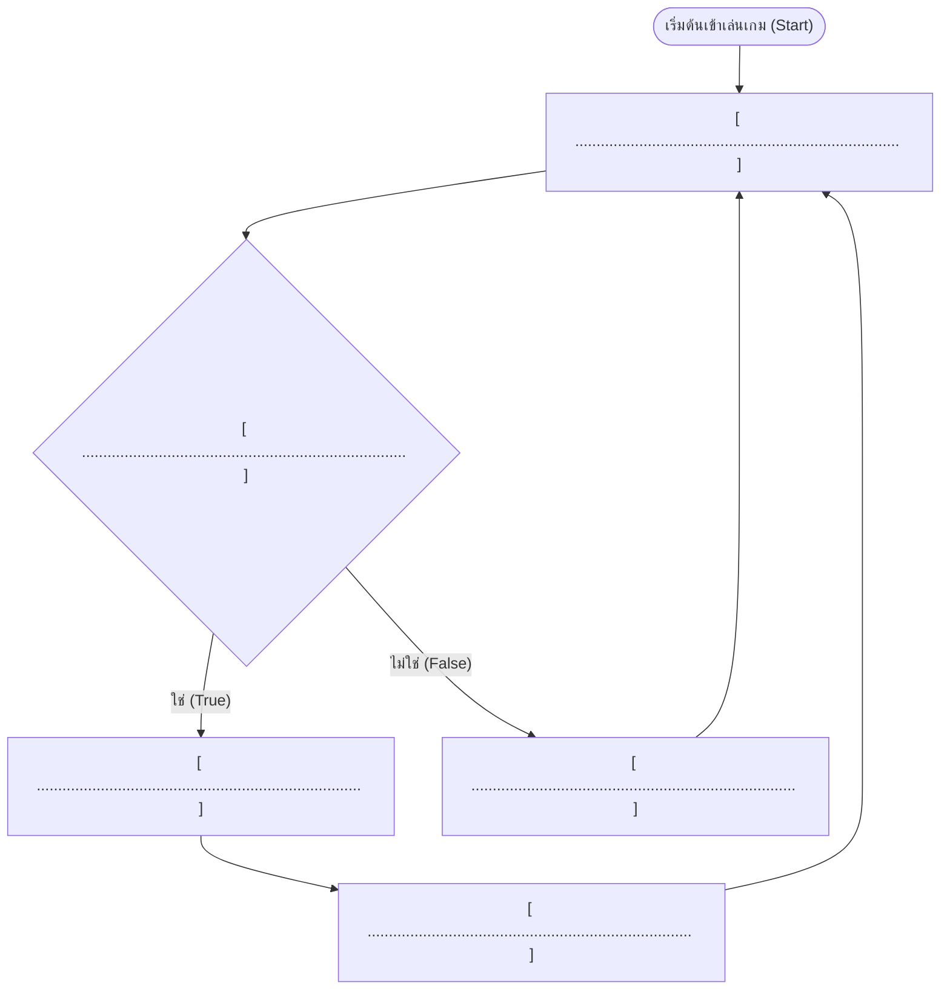

# แบบฝึกหัดและใบงานปฏิบัติการที่ 1
## รายวิชา 21901-2009 การสร้างเกมคอมพิวเตอร์ (Computer Game Programming)
### หัวข้อ: ตรรกะผังงานเกม (Game Flowchart) และการสร้างฉากลานจุดเกิด (Spawn Arena) บน Roblox Studio

> [!info] ข้อมูลผู้เรียนและการส่งงาน
> - **ชื่อ-นามสกุล:** ............................................................................ **รหัสนักศึกษา:** ....................................
> - **ระดับชั้น:** ปวช. 3 กลุ่มเรียน: 3ชทค2 **เลขที่:** ...........
> - **วันที่ปฏิบัติงาน:** วันจันทร์ คาบที่ 6–9 (13.00–17.00 น.) ห้องปฏิบัติการคอมพิวเตอร์ TC203
> - **คะแนนเต็ม:** 30 คะแนน (ทฤษฎีและตรรกะ 10 คะแนน · ปฏิบัติการและฉาก 20 คะแนน)

---

## ตอนที่ 1: แบบฝึกหัดทบทวนตรรกะและผังงานเกม (Logic & Flowchart) — 10 คะแนน

### 1.1 การจับคู่สัญลักษณ์ผังงานมาตรฐาน ANSI กับบทบาทในระบบเกม (4 คะแนน)
ให้นักศึกษานำตัวอักษรหน้าชื่อสัญลักษณ์ทางขวามือ มาเติมลงในช่องว่างหน้าความหมายทางซ้ายมือให้ถูกต้อง

| ข้อ | บทบาทหน้าที่ในระบบเกม | ตัวเลือกรหัสสัญลักษณ์ |
| :---: | :--- | :---: |
| ..... | 1. ตรวจสอบเงื่อนไข เช่น *"พลังชีวิตของผู้เล่นเท่ากับ 0 หรือไม่?"* | **ก.** Terminal (วงรี/แคปซูล) |
| ..... | 2. จุดเริ่มต้นเมื่อเปิดเกม (`Start Game`) หรือจุดสิ้นสุดเมื่อจบเกม (`Game Over`) | **ข.** Process (สี่เหลี่ยมผืนผ้า) |
| ..... | 3. การกระทำหรือคำนวณ เช่น *"เพิ่มคะแนน 10 แต้ม"*, *"ย้ายตำแหน่งตัวละคร"* | **ค.** Decision (สี่เหลี่ยมข้าวหลามตัด) |
| ..... | 4. การรับคำสั่งจากผู้เล่น เช่น *"กดปุ่ม Spacebar เพื่อกระโดด"* หรือแสดงผลข้อความ | **ง.** Input / Output (สี่เหลี่ยมด้านขนาน) |

---

### 1.2 การวิเคราะห์และออกแบบผังงานตรรกะ "ระบบตกเหวแล้วเกิดใหม่ (Fall & Respawn)" (6 คะแนน)
**สถานการณ์:** ในเกมแนวตะลุยด่าน (Obby) หากผู้เล่นกระโดดพลาดจนตัวละครตกจากแท่นลอยฟ้าลงสู่ความลึกพิกัดแกน Y ต่ำกว่า `-50` ระบบเกมจะถือว่าผู้เล่นเสียชีวิต และต้องส่งตัวละครกลับมาเกิดใหม่ที่ `SpawnLocation` เดิม

ให้นักศึกษานำข้อความที่กำหนดให้ด้านล่างนี้ ไปเติมลงในบล็อกผังงานให้ถูกต้องตามลำดับขั้นตอนตรรกะ:
1. `ตัวละครเดินและกระโดดในฉาก`
2. `ตรวจสอบพิกัดความสูง Y < -50 หรือไม่?`
3. `พลังชีวิต (Health) ลดเหลือ 0 และตัวละครสลายตัว`
4. `ส่งตัวละครกลับไปเกิดใหม่ที่ SpawnLocation`
5. `เล่นเกมต่อไปตามปกติ`



---

## ตอนที่ 2: ปฏิบัติการสร้างฉากและด่านทดสอบบน Roblox Studio (Hands-on Labs) — 20 คะแนน

> [!tip] กฎเหล็กประจำคาบ (Golden Rule)
> **"วางชิ้นส่วนปุ๊บ ติ๊กถูกที่ช่อง `Anchored` ปั๊บ!"** เพื่อตรึงวัตถุไว้กับพิกัดในอวกาศ ป้องกันไม่ให้วัตถุหล่นพังตามแรงโน้มถ่วง

ให้นักศึกษาเปิดโปรแกรม **Roblox Studio** เลือกเทมเพลต **Classic Baseplate** แล้วลงมือสร้างผลงานตาม 3 ระดับภารกิจ (Tier Challenges) ดังต่อไปนี้:

```
[ภารกิจที่ 1: ลานเกิดมาตรฐาน (ทุกคนต้องผ่าน)] ──> [ภารกิจที่ 2: ทางเดินทดสอบสเต็ปกระโดด] ──> [ภารกิจที่ 3: แสงสีและลูกเล่นท้าทาย]
```

### ภารกิจที่ 1: ลานจุดเกิดมาตรฐาน (First Spawn Arena - 10 คะแนน)
1. **วางแท่นเกิด (`SpawnLocation`):**
   - ลบภาพ Decal ด้านบนออก เพื่อให้พื้นผิวสะอาดตา
   - ปรับแต่ง `BrickColor` และเลือก `Material` ให้สวยงาม (เช่น `Neon`, `DiamondPlate`, `Marble`)
2. **สร้างแท่นยกฐาน (Podium & Steps):**
   - ใช้ชิ้นส่วน `Part (Block)` สร้างฐานรองแท่นเกิดให้ลอยสูงจากพื้นอย่างน้อย 4 Studs
   - สร้างบันไดทางขึ้นอย่างน้อย 3 ขั้น โดยใช้ `Block` หรือ `Wedge (ทางลาด)`
3. **เสาประดับ 4 มุม (Corner Pillars):**
   - สร้างเสาไฟประดับ 4 ต้นที่มุมแท่นเกิด (ใช้ `Cylinder` หรือ `Block`) และเปิดวัสดุเป็น `Neon` เพื่อให้มีแสงเรืองรอง
4. **เปิดคุณสมบัติ `Anchored` ทุกชิ้นส่วน:** ตรวจสอบว่าไม่มีชิ้นส่วนใดหลุดร่วงเมื่อกดปุ่ม **Play (F5)**

---

### ภารกิจที่ 2: เส้นทางสะพานกระโดดวัดระยะ (Mini-Parkour Pathway - 6 คะแนน)
*(สำหรับขยายเวลาเรียนรู้และฝึกกะระยะทางฟิสิกส์ 3 มิติ เพื่อไม่ให้คลาสว่าง)*
1. สร้างทางเดินเชื่อมออกจากลานเกิด เป็น **แท่นกระโดดลอยฟ้าจำนวน 4 แท่น**
2. กำหนดระยะห่างระหว่างแท่นให้ตัวละครสามารถกระโดดข้ามได้พอดี (ระยะห่างประมาณ 6–10 Studs)
3. ตกแต่งแต่ละแท่นด้วยสีที่แตกต่างกันเพื่อบอกระดับความยาก (เช่น เขียว $\rightarrow$ เหลือง $\rightarrow$ ส้ม $\rightarrow$ แดง)
4. ปลายทางของสะพาน ให้สร้าง **แท่นชัยชนะ (Goal Platform)** ขนาดกว้าง พร้อมเสาธงหรือสัญลักษณ์ฉลองความสำเร็จ

---

### ภารกิจที่ 3: ลูกเล่นบรรยากาศและการจัดหมวดหมู่ (Environment & Hierarchy - 4 คะแนน)
1. **การจัดกลุ่มวัตถุ (Grouping & Renaming):**
   - เลือก Part ทั้งหมดของลานเกิด แล้วกด **Ctrl + G** เพื่อรวมกลุ่มเป็น `Model`
   - เปลี่ยนชื่อ Model ในหน้าต่าง Explorer ให้สื่อความหมาย เช่น `Spawn_Podium`, `Parkour_Track`
2. **ปรับแต่งบรรยากาศ (Lighting):**
   - คลิกที่เซอร์วิส `Lighting` ในหน้าต่าง Explorer
   - ปรับเปลี่ยนค่า `TimeOfDay` เป็นช่วงเวลาที่ต้องการ เช่น พระอาทิตย์ตกดิน (`18:00:00`) หรือยามค่ำคืน (`00:00:00`) เพื่อดูแสงนีออนของเสาไฟ

---

## ตอนที่ 3: ตารางบันทึกผลการทดสอบและการแก้ปัญหา (Check & Debugging)

ให้นักศึกษาทดสอบโปรแกรมด้วยตนเอง แล้วทำเครื่องหมาย $\checkmark$ ในช่องผลการทดสอบ:

| รายการตรวจสอบ | ผ่าน | ไม่ผ่าน | วิธีแก้ไข / สาเหตุที่พบ |
| :--- | :---: | :---: | :--- |
| 1. ตัวละครเกิดบนแท่น `SpawnLocation` พอดี (ไม่จมพื้นและไม่ลอยกลางอากาศ) | [ ] | [ ] | ............................................................................ |
| 2. ชิ้นส่วนทุกชิ้นไม่ร่วงหล่นลงพื้นเมื่อเริ่มเกม (เปิด `Anchored` ครบถ้วน) | [ ] | [ ] | ............................................................................ |
| 3. ตัวละครสามารถกระโดดข้ามแท่นทางเดิน 4 แท่นไปยังแท่นปลายทางได้จริง | [ ] | [ ] | ............................................................................ |
| 4. โมเดลถูกจัดกลุ่มเป็นสัดส่วนในหน้าต่าง Explorer อย่างเป็นระเบียบ | [ ] | [ ] | ............................................................................ |

---

## ตอนที่ 4: คำถามวิเคราะห์ข้อผิดพลาดท้ายคาบ (Formative Evaluation)

1. หากนักศึกษาทดสอบกดปุ่ม **Play (F5)** แล้วพบว่า **"ตัวละครเดินทะลุกำแพงหรือเสาไฟประดับได้เหมือนผี"** แสดงว่าลืมตั้งค่าคุณสมบัติใดในหน้าต่าง Properties?
   - **ตอบ:** ........................................................................................................................................................

2. การบันทึกงานด้วยคำสั่ง **Save to Roblox** แตกต่างจากการกด **Publish to Roblox** อย่างไรในเชิงการเผยแพร่เกม?
   - **ตอบ:** ........................................................................................................................................................

---

## เกณฑ์การประเมินผลคะแนน (Rubric)

| รายการประเมิน | ดีมาก (Full Score) | ปานกลาง (Passing) | ต้องปรับปรุง (Need Work) | ได้คะแนน |
| :--- | :--- | :--- | :--- | :---: |
| **1. ตรรกะและผังงาน (ตอนที่ 1)** | จับคู่และวาดผังงานได้ถูกต้องสมบูรณ์ 100% (9-10 คะแนน) | มีข้อผิดพลาด 1-2 จุด แต่ลำดับขั้นตอนถูกต้อง (6-8 คะแนน) | ผังงานสับสน สัญลักษณ์ผิดพลาดส่วนใหญ่ (0-5 คะแนน) | ..... / 10 |
| **2. ลานเกิดและแท่น Podium (ภารกิจ 1)** | สวยงาม มีบันได เสาไฟ และ Anchored ครบทุกชิ้น (10 คะแนน) | ใช้งานได้ เกิดถูกจุด มี Anchored แต่ตกแต่งน้อย (6-8 คะแนน) | ตัวละครไม่เกิดบนแท่น หรือของร่วงพัง (0-5 คะแนน) | ..... / 10 |
| **3. สะพานกระโดด Parkour (ภารกิจ 2)** | มี 4 แท่น ระยะห่างกระโดดได้จริง มีแท่นปลายทาง (6 คะแนน) | มีแท่นกระโดด แต่ระยะห่างใกล้หรือไกลเกินไป (3-5 คะแนน) | ไม่มีแท่นกระโดด หรือชิ้นส่วนร่วงหล่น (0-2 คะแนน) | ..... / 6 |
| **4. ความเป็นระเบียบและแสง (ภารกิจ 3)** | รวม Group Model ตั้งชื่อเรียบร้อย ปรับ Lighting สวยงาม (4 คะแนน) | รวม Group Model แต่ไม่ได้ตั้งชื่อ (2-3 คะแนน) | วัตถุกระจัดกระจายใน Workspace ไม่ได้จัดกลุ่ม (0-1 คะแนน) | ..... / 4 |
| **รวมคะแนนทั้งสิ้น** | | | | **..... / 30** |

**ลายมือชื่อครูผู้ตรวจ:** .................................................................... **วันที่:** ........ / ........ / ................
