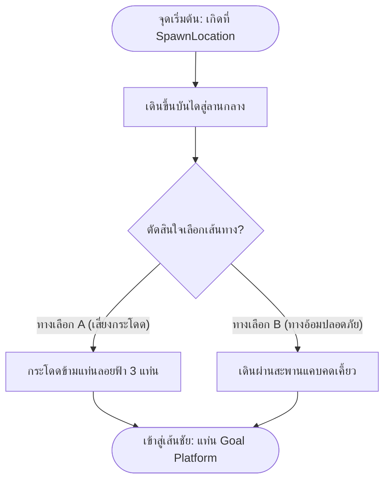

# แบบฝึกหัดและใบงานปฏิบัติการที่ 1
## รายวิชา 21901-2009 การสร้างเกมคอมพิวเตอร์ (Computer Game Programming)
### หัวข้อ: ผังงานพิมพ์เขียวด่านเกม (Level Flowchart Blueprint) และการสร้างฉาก 3 มิติจริงบน Roblox Studio

> [!info] ข้อมูลผู้เรียนและการส่งงาน
> - **ชื่อ-นามสกุล:** ............................................................................ **รหัสนักศึกษา:** ....................................
> - **ระดับชั้น:** ปวช. 3 กลุ่มเรียน: 3ชทค2 **เลขที่:** ...........
> - **วันที่ปฏิบัติงาน:** วันจันทร์ คาบที่ 6–9 (13.00–17.00 น.) ห้องปฏิบัติการคอมพิวเตอร์ TC203
> - **คะแนนเต็ม:** 30 คะแนน (ผังงานพิมพ์เขียว 10 คะแนน · ชิ้นงานฉาก 3 มิติจริง 10 คะแนน · การทดสอบ Playtest 10 คะแนน)

---

## 🎯 แนวคิดหลัก: "ผังงานคือพิมพ์เขียวสร้างฉากจริง (Blueprint to 3D World)"

ในอุตสาหกรรมเกม นักออกแบบด่าน (Level Designer) จะไม่เปิดคอมพิวเตอร์มาวางของมั่วๆ โดยไร้ทิศทาง แต่จะเริ่มต้นจากการ **"วาดผังงานเส้นทางการเล่น (Player Flowchart)"** ลงบนกระดาษก่อน เพื่อกำหนดว่า:
- ผู้เล่นเกิดตรงไหน?
- ต้องเดินไปเจอกับอะไร?
- มีทางแยกให้ตัดสินใจเลือกอย่างไร?
- และเส้นชัยอยู่ที่ไหน?

> [!important] กฎสำคัญของ Day 1
> **บทเรียนนี้ไม่มีการเขียนสคริปต์ (No Scripting)** ทุกอย่างทำงานด้วยระบบฟิสิกส์และการจัดฉากของ Roblox Engine ล้วนๆ ผังงานในใบงานนี้คือ **"แผนผังการไหลของด่าน (Level Progression)"** ที่นักศึกษาต้องวาดเอง แล้วสร้างฉากตามนั้นจริง!

---

## ตอนที่ 1: ออกแบบผังงานพิมพ์เขียวด่านเกม (Level Flowchart Blueprint) — 10 คะแนน

ให้นักศึกษาวาดผังงานมาตรฐาน ANSI Flowchart ลงในกรอบด้านล่าง เพื่อออกแบบ **"ด่านผจญภัยแรกของฉัน"** โดยต้องมีองค์ประกอบครบทั้ง 5 ส่วนดังนี้:

1. **จุดเริ่มต้น (Terminal: วงรี):** จุดเกิดของผู้เล่นบนแท่น `SpawnLocation`
2. **ทางเดินแรก (Process: สี่เหลี่ยมผืนผ้า):** บันไดหรือทางเดินนำสู่พื้นที่ส่วนกลาง
3. **ทางแยกตัดสินใจ (Decision: สี่เหลี่ยมข้าวหลามตัด):** ทางเลือกที่ผู้เล่นต้องตัดสินใจ (เช่น *"เลือกทางลัดเสี่ยงตก (Path A) หรือ ทางอ้อมปลอดภัย (Path B)?"*)
4. **อุปสรรคและเส้นทาง (Process):**
   - **ทางเลือก A:** ทางสะพานกระโดดลอยฟ้าข้ามเหว (สั้นแต่ท้าทาย)
   - **ทางเลือก B:** ทางเดินแคบคดเคี้ยว (ยาวแต่ปลอดภัยกว่า)
5. **จุดสิ้นสุด (Terminal: วงรี):** แท่นเส้นชัยแห่งชัยชนะ (`Goal Platform`)

### ✏️ พื้นที่วาดผังงานพิมพ์เขียวของนักศึกษา:



*(ให้นักศึกษาออกแบบรายละเอียดและวาดผังงานด่านของตนเองลงในช่องว่าง หรือวาดลงบนใบงานกระดาษ)*

---

## ตอนที่ 2: ปฏิบัติการสร้างฉากจริงตามพิมพ์เขียวบน Roblox Studio — 10 คะแนน

ให้นักศึกษาเปิดโปรแกรม **Roblox Studio** เลือกเทมเพลต **Classic Baseplate** แล้วลงมือสร้างฉาก 3 มิติให้ตรงตามผังงานที่ตนเองออกแบบไว้ในตอนที่ 1:

```
[1. วางแท่นเกิด Spawn] ──> [2. ประกอบทางแยก Decision] ──> [3. สร้าง 2 เส้นทาง (กระโดด & ทางอ้อม)] ──> [4. วางแท่นเส้นชัย Goal]
```

### รายการที่ต้องสร้างในฉาก 3 มิติจริง:
1. **แท่นจุดเกิด (Spawn Arena):**
   - วางวัตถุ `SpawnLocation` ปรับสีและวัสดุให้สวยงาม
   - สร้างฐานรองแท่นเกิดให้ยกสูงจากพื้นอย่างน้อย 4 Studs พร้อมบันไดทางขึ้น
2. **ลานทางแยกตัดสินใจ (Decision Junction):**
   - สร้างลานกว้างที่เป็นจุดเชื่อมต่อ และทำป้ายบอกทางหรือใช้สีแบ่งชัดเจนระหว่าง 2 เส้นทาง (เช่น ฝั่งซ้ายสีส้ม ฝั่งขวาสีฟ้า)
3. **การสร้าง 2 เส้นทางตามผังงาน:**
   - **เส้นทาง A (แท่นกระโดดลอยฟ้า):** วางแท่น Part ลอยกลางอากาศอย่างน้อย 3 แท่น เว้นระยะห่างกระโดด 6–8 Studs
   - **เส้นทาง B (ทางเดินแคบ):** ใช้ Part แผ่นยาว ทำทางเดินแคบที่มีมุมเลี้ยวคดเคี้ยว
4. **แท่นเส้นชัย (Goal Platform):**
   - สร้างแท่นปลายทางขนาดใหญ่ ตกแต่งด้วยเสาไฟ `Material = Neon` เพื่อเป็นจุดสังเกต
5. **กฎเหล็กทางฟิสิกส์:** ทุกชิ้นส่วน Part ที่สร้างขึ้น **ต้องติ๊กถูกที่ช่อง `Anchored` ใน Properties เสมอ** เพื่อไม่ให้ของร่วงหล่นพังลงมา

---

## ตอนที่ 3: ทดสอบการเล่นจริงเทียบกับผังงาน (Playtesting & Tuning) — 10 คะแนน

เมื่อสร้างฉากเสร็จ ให้กดปุ่ม **Play (F5)** เพื่อควบคุมตัวละครเดินทดสอบฉากจริงเทียบกับผังงาน แล้วบันทึกผลลงในตาราง:

| หัวข้อทดสอบจริง | ผลการทดสอบ (ผ่าน / ต้องแก้) | ปัญหาที่พบหน้างานจริง | วิธีแก้ไขด้วยเครื่องมือ Studio |
| :--- | :---: | :--- | :--- |
| **1. การเกิด:** ตัวละครเกิดบนแท่น `SpawnLocation` พอดี ไม่ติดบั๊กจมพื้น | [ ] ผ่าน &nbsp; [ ] ต้องแก้ | .................................................... | ปรับตำแหน่ง Y ของแท่นให้แตะพื้นพอดี |
| **2. ความมั่นคงของฉาก:** ไม่มีชิ้นส่วนใดร่วงหล่นลงพื้น Baseplate | [ ] ผ่าน &nbsp; [ ] ต้องแก้ | .................................................... | เลือก Part แล้วติ๊กเปิด `Anchored = true` |
| **3. เส้นทาง A (แท่นกระโดด):** ตัวละครสามารถกระโดดข้ามถึงเส้นชัยได้จริง | [ ] ผ่าน &nbsp; [ ] ต้องแก้ | .................................................... | ใช้เครื่องมือ `Move` ขยับระยะห่าง Studs ให้พอดี |
| **4. เส้นทาง B (ทางอ้อม):** ตัวละครเดินผ่านทางแคบเข้าสู่เส้นชัยได้จริง | [ ] ผ่าน &nbsp; [ ] ต้องแก้ | .................................................... | ปรับความกว้างของทางเดินด้วยเครื่องมือ `Scale` |
| **5. ความตรงตามพิมพ์เขียว:** ฉาก 3 มิติที่สร้างมีโครงสร้างตรงตามผังงาน | [ ] ผ่าน &nbsp; [ ] ต้องแก้ | .................................................... | ตรวจสอบทิศทางและป้ายบอกทางในฉาก |

---

## ตอนที่ 4: คำถามสะท้อนคิดจากการสร้างฉากจริง (Post-Lab Questions)

1. จากการทดสอบเดินในเส้นทาง A (แท่นกระโดด) ถ้านักศึกษาพบว่า **"ตัวละครกระโดดไม่ถึงแท่นถัดไป และตกลงไปข้างล่างตลอดเวลา"** ในฐานะนักออกแบบเกม นักศึกษาจะใช้เครื่องมือใดของ Roblox Studio ในการแก้ปัญหานี้ และแก้อย่างไร?
   - **ตอบ:** ........................................................................................................................................................
   - ................................................................................................................................................................

2. เหตุใดการวาด "ผังงานพิมพ์เขียว (Flowchart Blueprint)" ก่อนลงมือสร้างฉากในโปรแกรม จึงช่วยประหยัดเวลาและลดความผิดพลาดในการทำงานได้ดีกว่าการเปิดโปรแกรมแล้ววางของทันที?
   - **ตอบ:** ........................................................................................................................................................
   - ................................................................................................................................................................

---

## เกณฑ์การประเมินผลคะแนน (Scoring Rubric)

| รายการประเมิน | ยอดเยี่ยม (Full Score) | ผ่านเกณฑ์ (Passing) | ต้องปรับปรุง (Need Work) | ได้คะแนน |
| :--- | :--- | :--- | :--- | :---: |
| **1. ผังงานพิมพ์เขียว (ตอนที่ 1)** | ใช้สัญลักษณ์ ANSI ถูกต้อง มีจุดเกิด ทางแยก 2 ทาง และเส้นชัยชัดเจน (9–10 คะแนน) | สัญลักษณ์ถูกต้องเป็นส่วนใหญ่ ลำดับขั้นตอนเข้าใจได้ (6–8 คะแนน) | ผังงานสับสน ไม่มีทางแยก ไม่ตรงหลักการ (0–5 คะแนน) | ..... / 10 |
| **2. ชิ้นงานฉาก 3 มิติจริง (ตอนที่ 2)** | สร้างฉากตรงตามผังงานเป๊ะ มี 2 ทางเลือก มีแท่นเกิด เส้นชัย และ Anchored ครบ (9–10 คะแนน) | สร้างฉากได้ มีเส้นทาง แต่ตกแต่งน้อย หรือลืม Anchored บางชิ้น (6–8 คะแนน) | ฉากไม่ตรงตามผังงาน ไม่มีทางเลือก ชิ้นส่วนหลุดร่วง (0–5 คะแนน) | ..... / 10 |
| **3. การทดสอบ Playtest (ตอนที่ 3–4)** | บันทึกผลทดสอบครบ ตัวละครเดินและกระโดดผ่านได้จริงทั้ง 2 เส้นทาง (9–10 คะแนน) | บันทึกผลทดสอบ แต่เล่นผ่านได้แค่เส้นทางเดียว (6–8 คะแนน) | ไม่ได้ทำการ Playtest หรือฉากเล่นไม่ได้จริง (0–5 คะแนน) | ..... / 10 |
| **รวมคะแนนทั้งสิ้น** | | | | **..... / 30** |

**ลายมือชื่อครูผู้ตรวจ:** .................................................................... **วันที่:** ........ / ........ / ................
