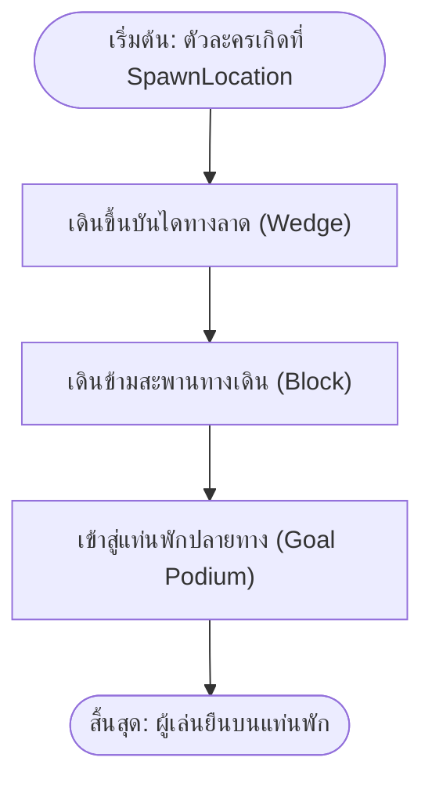

# แบบฝึกหัดและใบงานปฏิบัติการที่ 1
## รายวิชา 21901-2009 การสร้างเกมคอมพิวเตอร์ (Computer Game Programming)
### หัวข้อ: การควบคุมสภาพแวดล้อม Roblox Studio และการสร้างฉาก 3 มิติด้วยชิ้นส่วน Parts (ขอบเขตหน่วยที่ 1–2)

> [!info] ข้อมูลผู้เรียนและการส่งงาน
> - **ชื่อ-นามสกุล:** ............................................................................ **รหัสนักศึกษา:** ....................................
> - **ระดับชั้น:** ปวช. 3 กลุ่มเรียน: 3ชทค2 **เลขที่:** ...........
> - **วันที่ปฏิบัติงาน:** วันจันทร์ คาบที่ 6–9 (13.00–17.00 น.) ห้องปฏิบัติการคอมพิวเตอร์ TC203
> - **ขอบเขตบทเรียน:** สอดคล้องกับ **หน่วยที่ 1** (สภาพแวดล้อม Studio & จุดเกิด) และ **หน่วยที่ 2** (ชิ้นส่วน 3D Parts & ฟิสิกส์พื้นฐาน)
> - **คะแนนเต็ม:** 30 คะแนน (ผังงานลำดับขั้นตอน 10 คะแนน · การสร้างฉาก 3 มิติจริง 10 คะแนน · การทดสอบฟิสิกส์ 10 คะแนน)

---

## 🎯 จุดประสงค์เชิงปฏิบัติการ (ขอบเขตหน่วยที่ 1–2 เท่านั้น)

1. ควบคุมมุมกล้อง 3 มิติ (Viewport Navigation) ใน Roblox Studio ได้อย่างคล่องแคล่ว
2. วางตำแหน่งจุดเกิดตัวละคร (`SpawnLocation`) ได้อย่างถูกต้อง
3. สร้างและแปลงรูปทรงชิ้นส่วน 3D Parts พื้นฐานครบทั้ง 4 รูปทรง (`Block`, `Sphere`, `Wedge`, `Cylinder`) ผ่านเครื่องมือ Move, Scale และ Rotate
4. ปรับแต่งคุณสมบัติพื้นฐานในหน้าต่าง Properties: สี (`BrickColor`), วัสดุ (`Material`), การตรึงวัตถุ (`Anchored`) และการชน (`CanCollide`) ได้ถูกต้อง
5. วาดผังงานลำดับขั้นตอนแบบเส้นตรง (Linear Sequence Flowchart) แสดงการเดินทางของตัวละครจากจุดเกิดสู่จุดหมายในฉากที่ตนเองสร้างขึ้นจริง

---

## ตอนที่ 1: ผังงานลำดับขั้นตอนและการจำแนกชิ้นส่วน 3D (10 คะแนน)

### 1.1 ผังงานลำดับขั้นตอนการเดินในฉาก (Linear Sequence Flowchart) — 5 คะแนน
ให้นักศึกษาวาดผังงานลำดับขั้นตอนแบบเส้นตรง (Linear Flowchart) แสดงลำดับการเคลื่อนที่ของตัวละครในฉากที่กำลังจะลงมือสร้างจริง โดยเรียงลำดับจาก:
- จุดเริ่มต้นเกิดบนแท่น `SpawnLocation`
- เดินขึ้นทางลาด `Wedge`
- ข้ามสะพานทางเดิน `Block`
- ถึงแท่นพักปลายทาง `Goal Podium`



*(ให้นักศึกษาวาดผังงานลำดับขั้นตอนนี้ลงบนใบงานกระดาษ)*

---

### 1.2 การจับคู่รูปทรง 3D Parts กับองค์ประกอบในฉากจริง (5 คะแนน)
ให้นำตัวอักษรของรูปทรง Part (ก - ง) มาเติมหน้าองค์ประกอบฉากที่เหมาะสมที่สุด:

| ข้อ | องค์ประกอบในฉากจริง | ตัวเลือกลักษณะรูปทรง Part |
| :---: | :--- | :---: |
| ..... | 1. ทางลาดหรือบันไดทางขึ้นสู่แท่นเกิด | **ก.** `Block` (ทรงสี่เหลี่ยมลูกบาศก์) |
| ..... | 2. เสาไฟประดับทรงกลมกระบอก | **ข.** `Sphere` (ทรงกลม) |
| ..... | 3. พื้นสะพานทางเดิน และแท่นฐานลานเกิด | **ค.** `Wedge` (ทรงสามเหลี่ยมลิ่มทางลาด) |
| ..... | 4. ดวงโคมไฟกลมเรืองแสงประดับยอดเสา | **ง.** `Cylinder` (ทรงกระบอก) |

---

## ตอนที่ 2: ปฏิบัติการสร้างฉาก 3 มิติจริงตามผังงานบน Roblox Studio (10 คะแนน)

ให้นักศึกษาเปิดโปรแกรม **Roblox Studio** เลือกเทมเพลต **Classic Baseplate** แล้วลงมือสร้างฉาก 3 มิติโดยใช้ชิ้นส่วน Parts ครบทั้ง 4 ชนิดตามข้อกำหนดดังนี้:

```
[แท่นเกิด SpawnLocation] ──> [บันไดทางลาด Wedge] ──> [สะพานทางเดิน Block] ──> [เสาประดับ Cylinder+Sphere] ──> [แท่นพัก Goal]
```

### รายการปฏิบัติการสร้างฉาก:
1. **แท่นจุดเกิด (Spawn Area):**
   - วางชิ้นส่วน `Block` ทำเป็นฐานยกสูงจากพื้น Baseplate 2 Studs
   - วางแผ่น `SpawnLocation` ไว้ด้านบนแท่น ลบภาพ Decal ด้านบนออกเพื่อความสวยงาม
2. **ทางลาดเชื่อมต่อ (Ramp/Stairs):**
   - วางชิ้นส่วน `Wedge` วางแนบชิดกับแท่นเกิด เพื่อทำเป็นทางลาดให้ตัวละครเดินขึ้น-ลงได้อย่างราบรื่น
3. **สะพานทางเดิน (Connecting Bridge):**
   - ใช้ชิ้นส่วน `Block` ดึงขนาดยาวด้วยเครื่องมือ `Scale` (ความกว้างอย่างน้อย 4 Studs ความยาว 20–30 Studs) เชื่อมไปยังแท่นพักปลายทาง
4. **เสาไฟและแท่นพักปลายทาง (Pillars & Goal):**
   - สร้างแท่นพักปลายทางขนาดกว้าง 10x10 Studs
   - วางเสาไฟที่มุมแท่นโดยใช้ `Cylinder` และวางลูกแก้ว `Sphere` บนยอดเสา
   - ปรับวัสดุของ Sphere เป็น `Material = Neon` เพื่อให้เปล่งแสงเรืองรอง
5. **การกำหนดคุณสมบัติพื้นฐาน (Properties):**
   - เปลี่ยนสี `BrickColor` และวัสดุ `Material` (เช่น Wood, DiamondPlate, Marble, Neon) ให้เข้ากันอย่างสวยงาม
   - **กฎเหล็ก:** ชิ้นส่วนทุกชิ้นต้อง **ติ๊กถูกที่ช่อง `Anchored`** ใน Properties เสมอ

---

## ตอนที่ 3: ปฏิบัติการทดสอบคุณสมบัติฟิสิกส์ (Anchored & CanCollide) — 10 คะแนน

ให้นักศึกษาทดลองเปลี่ยนค่าคุณสมบัติในหน้าต่าง Properties เพื่อสังเกตพฤติกรรมฟิสิกส์จริงของตัวเกม แล้วบันทึกผลลงในตาราง:

### 3.1 การทดลองคุณสมบัติ `Anchored` (การตรึงตำแหน่งวัตถุ) — 5 คะแนน
1. ให้เลือกชิ้นส่วนสะพานทางเดิน 1 ชิ้น แล้ว **เอาเครื่องหมายถูกออกจากช่อง `Anchored` (Anchored = false)**
2. กดปุ่ม **Play (F5)** หรือ **Run (F8)** เพื่อสังเกตผล:
   - **ผลที่เกิดขึ้นกับชิ้นส่วนนั้น:** ........................................................................................................
   - **เพราะเหตุใดจึงเกิดผลเช่นนั้น:** ......................................................................................................
3. ปรับค่ากลับมาเป็น **`Anchored = true`** ตามเดิมเพื่อให้สะพานใช้งานได้

---

### 3.2 การทดลองคุณสมบัติ `CanCollide` (การตรวจจับการชนทางกายภาพ) — 5 คะแนน
1. ให้เลือกชิ้นส่วนเสาไฟประดับ 1 ต้น แล้ว **เอาเครื่องหมายถูกออกจากช่อง `CanCollide` (CanCollide = false)**
2. กดปุ่ม **Play (F5)** แล้วบังคับตัวละครเดินชนเสาต้นนั้น:
   - **ผลที่เกิดขึ้นเมื่อตัวละครเดินชนเสา:** ................................................................................................
   - **ประโยชน์ของการตั้งค่า `CanCollide = false` ในการสร้างเกม (ยกตัวอย่าง 1 ข้อ):**  
     *(เช่น ประตูหลอก, ทางเดินลวงตา, ม่านน้ำตก)* .........................................................................
3. บันทึกงานโปรเจกต์ด้วยการกดปุ่ม **Ctrl + S**

---

## เกณฑ์การประเมินผลคะแนน (Scoring Rubric)

| รายการประเมิน | ยอดเยี่ยม (Full Score) | ผ่านเกณฑ์ (Passing) | ต้องปรับปรุง (Need Work) | ได้คะแนน |
| :--- | :--- | :--- | :--- | :---: |
| **1. ผังงานและรูปทรง 3D (ตอนที่ 1)** | วาดผังงานลำดับขั้นตอนถูกต้อง และจับคู่รูปทรง Parts ครบถ้วน (9–10 คะแนน) | ผังงานถูกต้อง จับคู่ผิดไม่เกิน 1 ข้อ (6–8 คะแนน) | ผังงานสับสน จับคู่ผิดส่วนใหญ่ (0–5 คะแนน) | ..... / 10 |
| **2. ฉาก 3 มิติจริง (ตอนที่ 2)** | มีชิ้นส่วนครบ 4 ชนิด (Block, Wedge, Cylinder, Sphere) ลานเกิดสวยงาม Anchored ครบ (9–10 คะแนน) | มีชิ้นส่วนครบ ใช้งานได้ แต่ตกแต่งน้อย (6–8 คะแนน) | ขาดรูปทรงสำคัญ หรือลืม Anchored จนของพัง (0–5 คะแนน) | ..... / 10 |
| **3. การทดลองฟิสิกส์ (ตอนที่ 3)** | อธิบายผลลัพธ์ของ Anchored และ CanCollide ได้ถูกต้องตามหลักการ (9–10 คะแนน) | บันทึกผลการทดลองถูกต้องเป็นส่วนใหญ่ (6–8 คะแนน) | ไม่ได้ทำการทดลอง หรือบันทึกผลไม่ตรงความจริง (0–5 คะแนน) | ..... / 10 |
| **รวมคะแนนทั้งสิ้น** | | | | **..... / 30** |

**ลายมือชื่อครูผู้ตรวจ:** .................................................................... **วันที่:** ........ / ........ / ................
